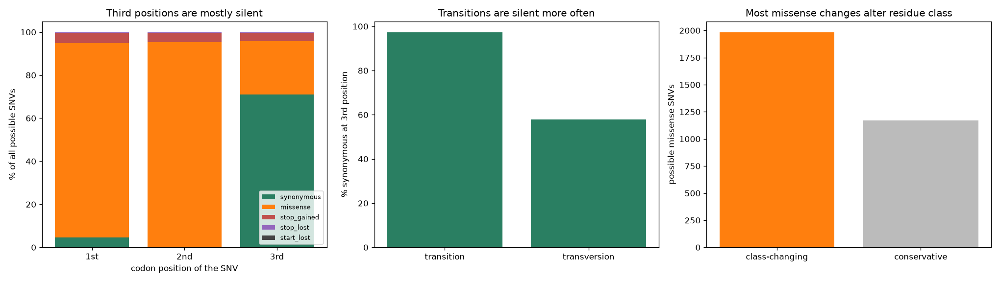

# Variant Effect Annotator

> "Missense" is a category, not a verdict.

## Demo Output



Produced from a simulated gene by `demo.py`: the consequence of every possible single-nucleotide change by codon position, how transitions and transversions differ, and how many missense changes swap a residue's chemical class.

## Why This Exists

VEP and SnpEff label millions of variants, and most people treat their output as ground truth without knowing how the labels are made. The core logic fits in one file: find the codon, swap the base, translate, compare. This repo does exactly that for SNVs and indels in a coding sequence, and writes HGVS-style notation (`c.214C>T`, `p.Arg72Ter`) so the output reads like the real tools.

## Consequences Handled

| Effect | Rule |
|--------|------|
| synonymous | Same amino acid (`p.Leu12=`) |
| missense | Different amino acid, flagged conservative or class-changing |
| stop_gained | New stop codon (`p.Arg72Ter`) |
| stop_lost / start_lost | The stop or the start Met is destroyed |
| frameshift | Indel length not a multiple of 3, plus where the new stop lands |
| inframe insertion/deletion | Indel length a multiple of 3 |

```python
from annotate import annotate
annotate(cds, [(213, "C", "T"), (400, "A", "ATT")])
```

## When NOT to Use This

- **Genome coordinates, transcripts and strands.** Real annotators map VCF positions through exons on either strand and across many transcripts. Here positions are already CDS-relative.
- **Splice sites, UTRs and regulatory variants** aren't covered at all.
- **Pathogenicity.** Consequence isn't impact. Use CADD, REVEL or AlphaMissense with care, and ACMG criteria for clinical work.

## The Uncomfortable Truth

The same variant can be synonymous on one transcript and missense on another. "The" consequence of a variant only exists once you've chosen a transcript, so say which one.

## Further Reading

- den Dunnen J. T. et al. "HGVS recommendations for the description of sequence variants: 2016 update." Human Mutation (2016).
- McLaren W. et al. "The Ensembl Variant Effect Predictor." Genome Biology (2016).
- Cingolani P. et al. "A program for annotating and predicting the effects of single nucleotide polymorphisms, SnpEff." Fly (2012).
